  
  
  

<h3 align="center">I work where offensive security meets AI, and I build AI agents that ask before they act.</h3>

 

## By the numbers

<table>
  <tr>
    <td align="center" width="33%" colspan="2"><h2>#1</h2>globally at <b>TraceBash CTF 2026</b> plus #2 RIFFHACK, 1st BushBash (ANU)</td>
    <td align="center" width="33%" colspan="2"><h2>487,523</h2>URLs in <b>MultiPhishDB</b> six script families, bilingual labels, κ = 0.91</td>
    <td align="center" width="33%" colspan="2"><h2>350 ms</h2>end-to-end <b>voice agent</b>, 7 languages Whisper + LLaMA 3.2 + Piper, under 2¢ a minute</td>
  </tr>
  <tr>
    <td align="center" width="50%" colspan="3"><h2>0 → ~10k</h2>users at V1 launch tech lead, multi-tenant Postgres with RLS</td>
    <td align="center" width="50%" colspan="3"><h2>45+</h2><b>hackathons and CTFs</b> HackMIT, Junction, OxHack, Meta, London × AI Science</td>
  </tr>
</table>

## Activity

  

## Featured work

<table>
  <tr>
    <td width="50%" valign="top">
      <h3><a href="https://github.com/jeevithg090/UniPhish">UniPhish</a></h3>
      
<b>Unicode-native phishing detection</b> · first-author research, manuscript for IEEE TIFS

      <ul>
        <li>Byte-level model that reads every Unicode character, where ASCII-vocabulary detectors map Arabic, CJK, Devanagari and Hangul to a single unknown token.</li>
        <li>Built <b>MultiPhishDB</b> (487,523 URLs) and reproduced the source IEEE paper end to end, correcting its parameter count and overstated claims.</li>
        <li>Grew into a platform: explainable verdicts for URLs, pages, emails, files and QR codes, plus <b>AgentGuard</b>, an MCP layer that screens what AI agents read and send.</li>
      </ul>
      
      
      
      
    </td>
    <td width="50%" valign="top">
      <h3><a href="https://github.com/jeevithg090/Steward">Steward</a></h3>
      
<b>Open-source personal AI agent</b> · OxHack 26, University of Oxford

      <ul>
        <li>An agent with its own browser, files and shell. Models plan; deterministic code decides every amount, permission and "yes".</li>
        <li>Governance on every tool call: deny rules, taint tracking that forces approval after untrusted input, outbound secret checks, an SSRF proxy and a hash-chained audit log.</li>
        <li>Red-teamed live: an injected "forward all invoices" email was refused, and signed mandates refused 10/10 forgery and scope attacks.</li>
      </ul>
      
      
      
      
    </td>
  </tr>
  <tr>
    <td width="50%" valign="top">
      <h3><a href="https://github.com/jeevithg090/AlertForge">SentinelForge</a></h3>
      
<b>Autonomous SOC war room</b> · LLM agents with a human in charge

      <ul>
        <li>Folds alert storms into single incidents, then a team of LLM agents triages, investigates and plans containment.</li>
        <li>A human approver stands in front of every action that changes production.</li>
      </ul>
      
      
      
    </td>
    <td width="50%" valign="top">
      <h3><a href="https://github.com/jeevithg090/IntentGuard">IntentGuard</a></h3>
      
<b>Risk-aware cross-chain treasury agent</b> · the AI decides, the chain enforces

      <ul>
        <li>Turns a goal like "move $5,000 USDC to the best safe yield, never above risk tier 2" into an ERC-7683-style cross-chain order.</li>
        <li>Scores every solver route on cited evidence, then runs an adversarial Proposer / Red Team / Arbiter review before anything moves.</li>
      </ul>
      
      
      
    </td>
  </tr>
  <tr>
    <td width="50%" valign="top">
      <h3><a href="https://github.com/jeevithg090/PromptAI">PromptForge</a></h3>
      
<b>Multi-agent GenAI platform</b> · automated evaluation built in

      <ul>
        <li>13 agents on a 13-state supervisor state machine, routing each step across Groq, Gemini, Cerebras and 345+ OpenRouter models.</li>
        <li>Every output scored on an auditable 8-dimension rubric, with fail-closed safety gates, citation-level RAG and bring-your-own-key envelope encryption.</li>
      </ul>
      
      
      
    </td>
    <td width="50%" valign="top">
      <h3><a href="https://github.com/jeevithg090/Axi0N_Meta">Rulecam</a></h3>
      
<b>Plain-language rules for any camera</b> · Meta Global AI Developer Hackathon 2026

      <ul>
        <li>Describe what worries you in your own language; Rulecam says honestly what a camera can and can't check and proves each rule before it goes live.</li>
        <li>A second Meta model reviews every alert before anyone is bothered, and the evidence is kept so anyone can check it.</li>
      </ul>
      
      
      
    </td>
  </tr>
</table>

<b>More things I've built</b>

 

| Project | What it is |
|---|---|
| [qPilot](https://github.com/jeevithg090/qpilot) | Open qPCR analysis with human-gated AI, co-built with a PhD scientist as a selected developer at London × AI Science. AI proposes, a deterministic engine checks, a scientist decides. |
| [Voice AI Model](https://github.com/jeevithg090/Voice-AI-Model) | Low-cost real-time voice agent for Hindi, Tamil, Telugu, Kannada and English, built only from open models on hardware you control. |
| [Apollo Omni-Indic](https://github.com/jeevithg090/Speech-to-Speech) | Research prototype of a speech-to-speech assistant for Indian hospital helplines, built around one transformer that both hears and speaks. |
| [Piper Tamil TTS](https://github.com/jeevithg090/FInal-Voice) | One resumable command that turns an AMD ROCm GPU server into a trained Tamil text-to-speech voice. |
| [GeoShardDB](https://github.com/jeevithg090/Distributed_System-Geo-Sharding) | Multi-region distributed database simulator: geo-sharded PostgreSQL, Redis caching and circuit-breaker failover. |
| [ComputerVision-Orchestra](https://github.com/jeevithg090/ComputerVision-Orchestra) | Multi-modal evidence review for damage claims: photos, chat and history in, an explained decision out. |
| [Keystone](https://github.com/jeevithg090/Prism) | AI agents read your syllabus, the job market and your code, and turn them into a roadmap from degree to industry. |

## Research

- **UniPhish: Unicode-native phishing URL detection.** First author, with Manipal faculty co-authors; manuscript for IEEE TIFS.
- **Project X, UofT AI (University of Toronto).** Selected for the global undergraduate ML research competition; cybersecurity research project, 2026–27, in progress.
- **Low-latency multilingual voice agent.** Research paper, Enigma, MAHE 2025: self-hosted Whisper + LLaMA 3.2 + Piper in six Indian languages plus English, benchmarked on an AMD Instinct MI300X.

**Interests:** agent security (prompt injection, tool-use permissions, sandboxing) · adversarial robustness and AI control · LLM evaluations · AI-enabled offensive security

## Experience

| | Role | When |
|---|---|---|
| **VoiceDots** | AI Voice Agent Developer: production GenAI voice agents (ASR → LLM → TTS over WebRTC) | Jul – Sep 2026 |
| **Ericsson** | Software Engineer Intern, Infrastructure & Network Security | May – Jul 2026 |
| **Colcord** | Full Stack Developer & Tech Lead: owned V1 from zero to ~10,000 users | Jul 2025 – Jan 2026 |
| **Kasturba Hospital** | AI Intern, Clinical ML: EHR pipelines and AI-versus-clinician agreement studies | Aug – Dec 2025 |

## Offensive security and awards

| | |
|---|---|
| 🥇 **TraceBash CTF 2026** | 1st place globally: reverse engineering, cryptography, web exploitation, binary analysis |
| 🥈 **RIFFHACK CTF 2026** | 2nd place globally: forensics, network exploitation, vulnerability research |
| 🥇 **BushBash CTF 2026** | 1st place, hosted by the Australian National University |
| 🛡️ **HTB CPTS** | Hack The Box Certified Penetration Testing Specialist |
| 🏛️ **HackMIT 2026** | 33rd worldwide in the admissions puzzle (top 50 earn entry); sponsor-track prize winner at MIT |
| ✨ **Selected** | London × AI Science developer cohort · Junction (Finland) travel grant · IIIT Hyderabad Hackathon finalist |

## Toolbox

  
   
  

- **Security:** penetration testing (CPTS), reverse engineering, binary analysis, web and network exploitation, cryptography, threat modelling, prompt-injection defences
- **ML and research:** adversarial training, knowledge distillation, quantisation, ablations, dataset construction, evaluation design
- **LLMs and agents:** orchestration, tool use and MCP, RAG, automated evals, open models (LLaMA, Qwen, Whisper via Ollama)

## Education

- **BSc (Hons) Computer Science**, University of Hertfordshire, UK · 2026–2027 · expected First Class Honours · transferred on a Merit Scholarship, Student Representative
- **BSc Computer Science Engineering**, ICAS, Manipal Academy of Higher Education, India · 2024–2026

 

  Looking for empirical AI security research: agent security, adversarial robustness, evals. 
  Say hello at <a href="https://jeevithg.dev">jeevithg.dev</a> or on <a href="https://www.linkedin.com/in/jeevith-gangadhara-782b21311">LinkedIn</a>.

